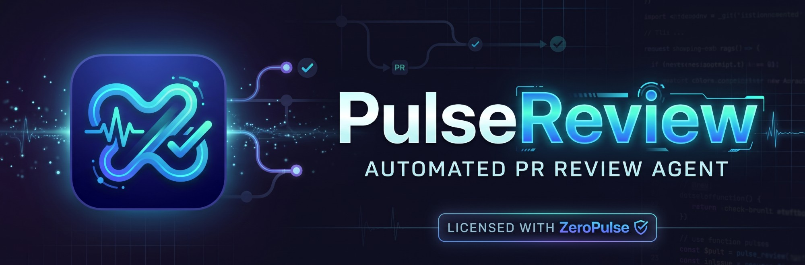
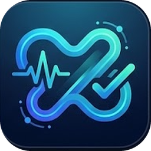

<p align="center">
  
</p>

<p align="center">
  <br>
  <b>AI pull-request reviews on your desktop · free models · you approve everything that gets posted</b>
</p>

<p align="center">
  <a href="https://pulse-review-three.vercel.app/"><b>🌐 Website</b></a> ·
  <a href="https://github.com/steventa2024-lgtm/Pulse-Review/releases/download/v0.1.2beta/PulseReview.exe"><b>⬇ Windows download</b></a> ·
  <a href="https://github.com/steventa2024-lgtm/Pulse-Review/releases/download/macos-v0.1.3-beta.1/PulseReview-macOS-arm64.dmg"><b>🍎 macOS Apple Silicon download</b></a> ·
  <a href="https://github.com/steventa2024-lgtm/Pulse-Review/releases">All releases</a>
</p>

# PulseReview

PulseReview is a desktop app for **Windows and Apple Silicon macOS** that reviews GitHub pull requests with AI. Choose a pull request and a model to generate findings checked against the actual diff, a risk rating, suggested fixes, and a proposed test file. **Nothing is posted to GitHub until you explicitly confirm it.**

Developed and licensed by **ZeroPulse**.

## Downloads

| Platform | Download | SHA-256 checksum | Requirements |
| --- | --- | --- | --- |
| **Windows** | [PulseReview.exe — v0.1.2 beta](https://github.com/steventa2024-lgtm/Pulse-Review/releases/download/v0.1.2beta/PulseReview.exe) | [Verify Windows EXE](https://github.com/steventa2024-lgtm/Pulse-Review/releases/download/v0.1.2beta/PulseReview.exe.sha256) | Windows 10/11, 64-bit (x64); no Python installation required |
| **macOS Apple Silicon** | [PulseReview-macOS-arm64.dmg — v0.1.3 Beta 1](https://github.com/steventa2024-lgtm/Pulse-Review/releases/download/macos-v0.1.3-beta.1/PulseReview-macOS-arm64.dmg) | [Verify macOS DMG](https://github.com/steventa2024-lgtm/Pulse-Review/releases/download/macos-v0.1.3-beta.1/PulseReview-macOS-arm64.dmg.sha256) | Apple Silicon M1–M4; macOS 14+ compatibility target; **Intel Macs not supported** |

See the [Windows release notes](https://github.com/steventa2024-lgtm/Pulse-Review/releases/tag/v0.1.2beta), [Mac beta release notes](https://github.com/steventa2024-lgtm/Pulse-Review/releases/tag/macos-v0.1.3-beta.1), and [all releases](https://github.com/steventa2024-lgtm/Pulse-Review/releases).

**Beta status:** The macOS version passed **251 tests** and packaged WKWebView/Keychain/DMG checks on GitHub's Apple Silicon **macOS 15** runner. Physical M2–M4 devices, macOS 14, fresh-user Gatekeeper behavior, and live GitHub/OpenRouter/Ollama/Docker integrations have **not** yet been independently tested. This is a public **prerelease**, not a notarized production app.

## Install on macOS (Apple Silicon)

1. Download [**PulseReview-macOS-arm64.dmg**](https://github.com/steventa2024-lgtm/Pulse-Review/releases/download/macos-v0.1.3-beta.1/PulseReview-macOS-arm64.dmg) from the verified [macOS Beta 1 release](https://github.com/steventa2024-lgtm/Pulse-Review/releases/tag/macos-v0.1.3-beta.1). Optionally download its [SHA-256 file](https://github.com/steventa2024-lgtm/Pulse-Review/releases/download/macos-v0.1.3-beta.1/PulseReview-macOS-arm64.dmg.sha256).
2. **Optional integrity check:** Open Terminal in the download folder and run:

   ```bash
   shasum -a 256 -c PulseReview-macOS-arm64.dmg.sha256
   ```

   The result should say `PulseReview-macOS-arm64.dmg: OK`. The expected DMG SHA-256 is `94cec8c38b375f77c053acf5202c5d46b7ee3e6aa493b15b16b954dcbcef45aa`.
3. Double-click the DMG in Finder, **drag PulseReview.app into Applications**, then eject the disk image.
4. Open **Applications → PulseReview**. If macOS blocks it because the beta is **ad-hoc signed and not notarized**, try opening it once, then follow [Apple's supported instructions](https://support.apple.com/en-us/102445): go to **System Settings → Privacy & Security → Open Anyway**, if that option is offered for PulseReview. Only proceed if you trust the verified file. Do **not** disable Gatekeeper, SIP, quarantine, or system-wide protections. If macOS reports malware or a damaged app, stop and get a fresh verified download.
5. Allow PulseReview to use your login **Keychain** if prompted; the app stores GitHub tokens and API keys there. Settings, history and logs live in `~/Library/Application Support/ZeroPulse/PulseReview/`.
6. Open **Settings → AI models** and choose an installed local **Ollama** model or a free **OpenRouter** model using your own API key. Ollama and its models are not bundled. Docker is optional and must be installed separately to execute generated tests in an isolated container.

If the native macOS window cannot initialize, PulseReview can open in a local browser and display a **Quit** control. Closing a browser tab alone may not stop the local server.

For more details, see [Mac installation documentation](docs/MACOS_INSTALL.md) and the [Mac beta release notes](https://github.com/steventa2024-lgtm/Pulse-Review/releases/tag/macos-v0.1.3-beta.1).

## Install on Windows

1. Download [**PulseReview.exe**](https://github.com/steventa2024-lgtm/Pulse-Review/releases/download/v0.1.2beta/PulseReview.exe) and run it on Windows 10/11 (64-bit). Python is not required.
2. This beta is not code-signed; Windows SmartScreen may warn on first launch. Only proceed if you trust the verified download.
3. Open **Settings → AI models** and select Ollama (install [Ollama](https://ollama.com) and a model separately) or a verified free [OpenRouter](https://openrouter.ai) model with your own key.

## Getting started

1. **Pick an AI model** in **Settings → AI models**. Ollama runs locally without an API key; OpenRouter requires your own account/key and its free-tier limits apply.
2. **Review a pull request:** **New review → paste a public PR URL → Start review**.
3. *(Optional)* In **Settings → GitHub**, authenticate to access private repositories or publish comments, which always require separate confirmation.
4. *(Optional)* Install **Docker Desktop** to run generated tests in an isolated sandbox. Generating tests does not mean they were executed.

Credentials are stored locally using **Windows DPAPI** or **macOS Keychain**. Local Ollama inference stays on your computer; hosted OpenRouter inference sends the selected review context to OpenRouter under its service policies. No credentials are sent to ZeroPulse.

## Features

- AI pull-request review with diff-grounded findings, risk ratings and suggested fixes
- Generated tests with optional isolated Docker execution
- **Code reviewer:** audit an entire repository, directory, or file for security, bugs, performance and maintainability
- Free OpenRouter models (subject to provider rate limits) or locally installed Ollama models
- Manual approval before publishing any review comments to GitHub
- Review history, watched repositories and Test lab

## Feedback

Encounter a problem? [Open a GitHub issue](https://github.com/steventa2024-lgtm/Pulse-Review/issues) with your OS version, CPU architecture and steps to reproduce. Never include tokens, keys or private code.

## Contributors

<a href="https://github.com/steventa2024-lgtm"></a>

- **ZeroPulse** ([@steventa2024-lgtm](https://github.com/steventa2024-lgtm)): creator, developer and licensor

## License

PulseReview is proprietary beta software, © 2026 ZeroPulse. See [LICENSE](LICENSE).

## What's in this repository

- `website/`: source for the [PulseReview website](https://pulse-review-three.vercel.app/)
- `.github/workflows/release.yml`: existing Windows release workflow
- `.github/workflows/macos.yml`: independent Apple Silicon CI candidate workflow
- `docs/MACOS_INSTALL.md`: macOS-specific installation and security guidance
